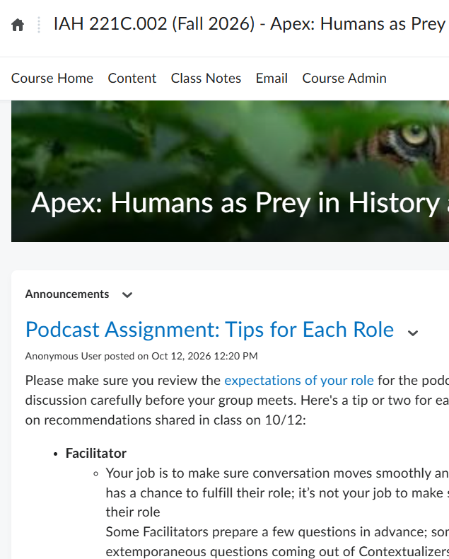

# IAH Accessibility Workshop
**Scott Schopieray, Ph.D.**
schopie1@msu.edu
10.23.2026

---

# General Plan 
How we are going to spend our time:

**11:00-11:30** - The basics and overview of Big Issues
	The importance of course accessibility
	Digital accessibility in the context of internal and federal deadlines

**11:30-12:00** - Live Review of IAH 221C
	Common course accessibility concerns and some simple solutions
	
**12:00-12:30** - Wrap-Up, Questions, Ideas
	Resources
	Questions

--- 

# The Basics

--- 

# Digital Accessibility 
## Compliance vs. Broader Inclusion (policy, pedagogy and practice)

--- 

# What's Driving This? 
Federal and Local Deadlines
- Federal Deadline of April 2027 
	- Title II of ADA requires all digital content be WCAG 2.1 AA accessible
	- Includes LMS pages (D2L), PDFs, PowerPoints, and videos.
- Local Deadline of January 1, 2026 (PAST!!!)
	- All NEW content must be WCAG 2.2 AA accessible
	- Units must work to remediate older content in use before the April 2027 Federal Deadline
--- 
# Why Does all This Matter?
- The 1 in 5 Rule: Approx. 21% of undergraduates report having a disability. ([NCES data)](https://nces.ed.gov/fastfacts/display.asp?id=60)
- [The Curb-Cut Effect](https://uxdesign.cc/the-curb-cut-effect-universal-design-b4e3d7da73f5): Features like captions help ESL learners; headers help mobile users scan content.
- Proactive vs. Reactive: Building for access now prevents (some, but not all) last-minute scrambles for individual accommodations later.
--- 
# Accessibility and Your Courses: Common Issues and Their Fixes
--- 
# 6 Most Common Issues we See
- Inaccessible PDFs used for readings
- Syllabus, Slides or Documents converted to inaccessible PDF
- Word or PowerPoint slides with accessibility issues
- Images in the course that need descriptions or lack contrast
- Inaccessible Links
- Video or Audio without accurate transcripts

--- 
# Inaccessible PDFs used for readings
---
_Inaccessible PDFs used for readings_
# This is the #1 issue impacting accessiblity
- Copier scans are essentially photos
- Even with OCR, PDFs don’t have Tags and Metadata
- Tags, Metadata and OCR only get us so far
---
_Inaccessible PDFs used for readings_
# Why Untagged or OCR’d PDFs are Problematic
- Screen readers can’t interpret the content or structure
- Text in scanned PDFs is just an image, not readable text
- No headings, lists, or navigation landmarks
- Users can’t search, copy, or zoom text effectively
---
# What to do about it…
_Inaccessible PDFs used for readings_
- **Ideal Solution**: Don’t use PDF’s.
	- Whenever possible use documents in their original format (e.g. Word or PowerPoint) or use etexts from the MSU Library** or Internet Search
- Secondary Solution: Use Optical Character Recognition (OCR) to convert images into selectable, searchable text and export it as a Word Document, then run the Word Accessibility Checker ***

<small>** Make sure to link to etexts, many books and journals have both HTML and PDF options
*** Ensure you are aware of copyright issues when scanning or modifying any documents you hae not created </small>

--- 
# Syllabus, Slides or Documents converted to inaccessible PDF

---
_Syllabus, Slides or Documents converted to inaccessible PDF_
# What it is
- Syllabus, Lecture slides, course handouts, etc. exported to PDF without preserving the original document's underlying accessibility tags, structural hierarchy, or alt text.
- Documents printed directly to PDF via basic print drivers rather than exported using designated "Save as Accessible PDF" or native conversion tools.
---
_Syllabus, Slides or Documents converted to inaccessible PDF_
# Why it's problematic
- Strips out reading order, heading levels, image descriptions, and table headers, forcing screen readers to read content out of order or skip it entirely.
- Destroys navigation landmarks, making it impossible for students using keyboard-only navigation to jump between sections efficiently.
---
_Syllabus, Slides or Documents converted to inaccessible PDF_
# What to do about it
- Don't convert to PDF! Just use the file in its original format
- If you use Google Docs consider publishing the Google Doc and linking to it from D2L
- Use the application's built-in export features (e.g., Word/PowerPoint's "Save as PDF" with "Document structure tags for accessibility" enabled) instead of "Print to PDF." x

--- 
# Word or PowerPoint slides with accessibility issues
---
_Word or PowerPoint slides with accessibility issues_
# What it is
- Files containing untagged images, custom text boxes added out of sequence, poor color contrast, skipped heading levels, or tables used purely for visual layout.
- Documents created without using structured slide layouts or native style hierarchies, relying instead on manual font sizing and bolding for appearance.
---
_Word or PowerPoint slides with accessibility issues_
# Why it's problematic
- Screen readers read slide elements in the exact order they were created rather than their visual position, leading to confusing and scrambled audio playback.
- Low contrast text (e.g., light gray on white) and missing alt text make essential information unreadable for students with low vision or color blindness.
---
_Word or PowerPoint slides with accessibility issues_
# What to do about it
- Use pre-formatted slide layouts and built-in heading styles, and verify reading order using PowerPoint's Selection Pane or Word's Navigation Pane.
- Run the integrated Accessibility Checker in Microsoft Office (`Review` > `Check Accessibility`) to fix flagged issues before sharing files with students.
--- 
# Images in the course that need descriptions or lack contrast
---
_Images in the course that need descriptions or lack contrast_
# What it is
- Graphics, diagrams, charts, or embedded text visuals lacking alternative text (alt text) or using color combinations with insufficient luminance contrast against the background.
- Course visuals that convey critical instructional information through visual appearance alone without a textual equivalent.
---
_Images in the course that need descriptions or lack contrast_
# Why it's problematic
- Students using screen readers receive no context for missing alt text (hearing only "image" or a file string like "img_004.jpg"), missing vital learning concepts.
- Students with low vision or color vision deficiencies cannot distinguish details, text, or data trends embedded in low-contrast graphics.
---
_Images in the course that need descriptions or lack contrast_
# What to do about it
- Add concise, meaningful alt text to informative images (or mark decorative images as "decorative") directly within your authoring tool or D2L.
- Test all image colors using a Contrast Checker tool to ensure a minimum contrast ratio of 4.5:1 for standard text/graphics and 3:1 for large text.
---
_Images in the course that need descriptions or lack contrast_
# Extra Tips
- Not every image needs a long description; if it’s purely for look or decoration it should be marked as decorative to save the user time.
- Alt text is only helpful for images that convey information that is not already on the page!

--- 
# Inaccessible Links
---
_Inaccessible Links_
# What it is
- Hyperlinks embedded in course materials that use vague text (such as "click here," "read more," or raw, long URLs) instead of descriptive link text.
- Links that lack visible indicators (like underlines or distinct color contrast) or that break keyboard navigation by missing proper focus indicators. 
---
_Inaccessible Links_
# Why it's problematic
- Screen reader users often pull up a list of all links on a page to navigate quickly; vague text like "click here" provides zero context about where the link leads.
- Raw URLs are read aloud letter-by-letter by screen readers, creating an annoying, unhelpful experience, while low-contrast link colors hinder low-vision users.
---
_Inaccessible Links_
# What to do about it
- Format hyperlinks using meaningful, descriptive text that clearly indicates the target destination (e.g., "Review the Course Syllabus" instead of "Click Here").
- Avoid pasting raw URLs directly into document text unless the material is intended to be printed, and ensure links are styled with distinct visual cues like underlines.

--- 
# Video or Audio without accurate transcripts
---
_Video or Audio without accurate transcripts_
# What it is
- Video or audio content provided without closed captions, accurate transcripts, or synchronizable text equivalents for spoken content.
- Automatic captions generated by modern media platforms (like MSU MediaSpace) that remain unedited, leaving speech recognition errors, misheard jargon, or missing punctuation intact.
---
_Video or Audio without accurate transcripts_
# Why it's problematic
- Inaccurate or missing captions create severe barriers for deaf or hard-of-hearing students, while spreading misinformation through garbled technical terminology.
- Can prevent students in noise-sensitive environments, English language learners, and neurodiverse students from effectively comprehending or searching through lecture materials.
--- 
_Video or Audio without accurate transcripts_
# What to do about it
- Generate initial automatic captions using your video platform, then review and correct errors using the platform's built-in caption editor before publishing.
- Provide a clean, downloadable text transcript for standalone audio files or pre-recorded video lectures, ideally starting from a prepared script whenever possible.

--- 

# Sample Course Review and Remediation
- Using Garth's IAH 221C
- [Course Review Email](https://docs.google.com/document/d/1hLXgVChQyWyoarMfZ6Oja-cUJzIn2V5QaYhW8TwKKZo/edit?usp=sharing)
- [MSU D2L](https://d2l.msu.edu/)

--- 
# Tools We'll be Using
- Spartan Ally - This is built into D2L and can help to identify issues and rectify some of them
- [Course Inventory Tool | D2L Help | Michigan State University](https://help.d2l.msu.edu/msu-docs/course-inventory-tool)
- Microsoft Word and PowerPoint - To work with content files
- Abbyy Finereader ($) - To do high-quality OCR and check for accuracy
- Adobe Acrobat Pro ($) - To create tags and check reading order

<small> _Abbyy Finereader is about $75 per year and Adobe Acrobat Pro is about $250 per year (it comes with Adobe Creative Cloud). There is no good alternative tool to Adobe Acrobat Pro for tagging PDFs that we have found and unfortunately Adobe's licensing model no longer allows for perpetual licensing_</small>

--- 
# Resources and Questions

---

# Other Potentially Useful Tools/Resources
- [WebAIM Contrast Checker](https://webaim.org/resources/contrastchecker/)
- [Guide to Scanned, Non-OCR, or Untagged PDFs](https://docs.google.com/document/d/1V72nfYwDz6qBKfdPjRWObZBNbkZxqN38Z2Z3QC5nT28/edit?tab=t.0#heading=h.r5tl4sakamab)
- [Accessible Microsoft Word Documents](https://docs.google.com/document/d/1EEJSDawxdX5NwYbGtCADoXNv3LqEdk_jHcdeI6aLO7I/edit?usp=sharing) 
- [Spartan Ally Training is Available in a Self Paced Course on D2L](https://webaccess.msu.edu/tools/spartan_ally)
- Free checkers (e.g., WAVE, [SilkTide](https://silktide.com/toolbar/), etc)
- [Accessibility and Inclusion - College of Arts & Letters](https://cal.msu.edu/faculty/staff-resources/accessibility/)
- [Digital Accessibility](https://webaccess.msu.edu/)
- [Spartan Ally | Digital Accessibility](https://webaccess.msu.edu/tools/spartan_ally)

---

# What about AI Tools?
AI tools can be useful in providing OCR or document structure, they are not very good at generating tagged PDFs or remediation. MSU has campus licensing for Google Gemini if you wish to experiment with AI assisted course accessibility. Please be aware of copyright considerations and restrictions if you choose to use AI tools in this (or any) work of this nature.

---

# Library Resources
If the request is for a specific course, Faculty may submit this form: [Reserve Book, E-book, CD, DVD Purchase Request](https://lib.msu.edu/request-reservepurchase "https://lib.msu.edu/request-reservepurchase") for a Reserve book, or they may submit this form: [Suggest a Purchase](https://lib.msu.edu/secure/currentAll/contact/suggestapurchase) to request a general purchase request.

If a PDF accessed through the MSU Libraries is inaccessible for a specific student (or staff) with an accessibility accommodation, they or the faculty can submit a material modification/remediation request: [Accessibility Remediation Request Form](https://lib.msu.edu/general/access-remediation/form)

---
# Library Resources cont.

We encourage faculty to link to an e-resource’s landing page. Some ebooks and ejournal articles are available not just as PDFs, but also HTML, ePub, or text-speech. Here’s an [**_article example_**](https://go-gale-com.proxy1.cl.msu.edu/ps/retrieve.do?tabID=Journals&resultListType=RESULT_LIST&searchResultsType=SingleTab&retrievalId=cbda5384-507a-4cd0-b6a1-38f46c1b77b8&hitCount=21775&gtmSearchId=6a7a0ac6-cd83-4b6c-a7dc-42b1eaa71bd0&searchType=AdvancedSearchForm&currentPosition=4&docId=GALE%7CA903626527&docType=Report&sort=Relevance&contentSegment=ZXBE-MOD1&prodId=GPS&sourceProductId=&pageNum=1&contentSet=GALE%7CA903626527&searchId=R4&userGroupName=msu_main&inPS=true "https://go-gale-com.proxy1.cl.msu.edu/ps/retrieve.do?tabID=Journals&resultListType=RESULT_LIST&searchResultsType=SingleTab&retrievalId=cbda5384-507a-4cd0-b6a1-38f46c1b77b8&hitCount=21775&gtmSearchId=6a7a0ac6-cd83-4b6c-a7dc-42b1eaa71bd0&searchType=AdvancedSearchForm&currentPosition=4&docId=GALE%7CA903626527&docType=Report&sort=Relevance&contentSegment=ZXBE-MOD1&prodId=GPS&sourceProductId=&pageNum=1&contentSet=GALE%7CA903626527&searchId=R4&userGroupName=msu_main&inPS=true") that has HTML, PDF, ways to change the font size, text-to-speech. 

Faculty are discouraged from uploading PDFs from library e-resources directly into D2L - see the first question on our  [**_copyright FAQ_**](https://lib.msu.edu/copyright/faq "https://lib.msu.edu/copyright/faq")**_._**

---

# Questions?
[schopie1@msu.edu](mailto:schopie1@msu.edu)
Teams is often the best way to get in touch!